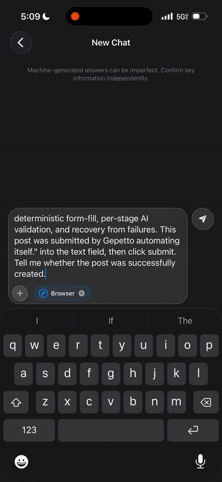

<p align="center">
  
  
  
</p>

<h1 align="center">🎭 Gepetto</h1>

<p align="center">
  <strong>A browser agent for iOS and macOS that a person can take over at any time.</strong><br>
  <em>Real WKWebView · any model, including small on-device ones · native SwiftUI</em>
</p>

<p align="center">
  <a href="https://github.com/haplollc/Gepetto/releases/download/demo-assets/gepetto_demo.mp4">
    
  </a>
</p>

---

Gepetto drives a real `WKWebView` from a natural-language task. The model sees the page as a short numbered list of elements, picks one action per step as JSON, and the agent runs it, checks what changed, and tells the model. The person watching can pause, take over the page (sign in, solve a captcha, pay), hand it back, and approve anything sensitive before it happens.

It ships the whole thing: the engine, the agent loop, the control API, and a polished SwiftUI panel.

## What's in the box

| | |
|---|---|
| **Observation** | Numbered interactive elements with stable refs, viewport-first visible text, "pages below" scroll hints, elements new since the last step marked `*`. Shadow DOM and same-origin iframes included; elements hidden under modals left out. |
| **Actions** | `click`, `type` (with Enter), `select`, `set_checked`, `scroll`, `scroll_to`, `press`, `navigate`, `search`, `back`, `wait`, `extract`, `ask_user`, `done`. All by element index. |
| **Reliability** | Waits for the DOM to go quiet, dismisses cookie banners, auto-closes JavaScript dialogs and reports them, verifies typed values, detects repeated actions and stagnant pages, warns the model when its step budget runs low. |
| **Small-model help** | One compact prompt per step (no growing transcript), a forgiving JSON parser that repairs the usual mistakes, explicit receipts ("URL changed", "3 new elements", "nothing visible changed"). |
| **Human in the loop** | Take over / hand back with a summary of what the person changed, approval cards for purchases / sends / deletes, automatic hand-over for captchas, verification codes and payment forms, pause / resume / stop. |
| **UI** | `AgentBrowserPanel`: the live page with numbered marks and a cursor that glides to each target, the model's thought line, a step timeline, and the control cards. |
| **Bring your own model** | `GepettoAIEngine` is one streaming function. Works with llama.cpp, MLX, Apple Foundation Models, or any HTTP API. |

## Installation

```swift
dependencies: [
    .package(url: "https://github.com/haplollc/Gepetto.git", from: "2.0.0")
]
```

## Quick start

```swift
import Gepetto

let agent = BrowserAgent()          // see BrowserAgentConfiguration for knobs

await agent.run(task: "Find the top story on news.ycombinator.com and tell me what it is",
                engine: myEngine) { event in
    switch event {
    case .thinking(let text):      print("💭", text)
    case .step(let step):          print("▶︎", step.label, "→", step.outcome)
    case .control(let state):      print("⏯", state)
    case .complete(let answer):    print("✅", answer)
    case .failed(let reason, _):   print("❌", reason)
    default: break
    }
}
```

`myEngine` is anything that conforms to `GepettoAIEngine`:

```swift
final class MyEngine: GepettoAIEngine {
    func stream(messages: [GepettoMessage], systemPrompt: String?) -> AsyncThrowingStream<String, Error> {
        // call your model, yield text chunks
    }
}
```

## Show it

```swift
struct ChatScreen: View {
    @StateObject var agent = BrowserAgent()

    var body: some View {
        AgentBrowserPanel(agent: agent, stageHeight: 380, accent: .blue) {
            agent.shutdown()
        }
    }
}
```

The panel is the whole experience: the page with numbered marks on everything the model can see, a cursor that moves to each target, the thought line, the timeline, and buttons for **Pause**, **Take over** and **Stop**. When the agent needs the person, a card appears on the page itself.

## Letting people take over

```swift
agent.takeOver()                       // the page becomes interactive, the agent waits
agent.handBack(note: "I logged in")    // the agent re-reads the page and continues
agent.pause(); agent.resume(); agent.stop()
agent.respond(allow: true)             // answer an approval card
```

What the model is told after a hand-back:

> The user took over the browser for 42 seconds and has handed control back. The page changed from https://a.com/login to https://a.com/home. Fields the user filled: Email ("jc@x.com"), Password (hidden). Resolved: login. The user says: I logged in. Continue the task from the current page. Do not redo what the user did.

Hand-over happens by itself for captchas, verification codes and payment forms (`configuration.handOverBlockers`), or whenever the model replies with `ask_user`. The person's input is never read while they are in control.

### Sensitive actions

Buttons that buy, send, delete or change an account are classified by their label (and a generic "Confirm" next to a price counts as a purchase). The default rules ask first for purchases, sends and deletes, and block account changes:

```swift
var config = BrowserAgentConfiguration()
config.sensitiveActions = .permissive        // trusted automation
config.sensitiveActions.policies[.send] = .allow
```

## What the model sees

Each step the model gets one message:

```
TASK: Find the top story on news.ycombinator.com

MEMORY (your notes so far): (nothing yet)

PREVIOUS STEPS:
1. navigate(https://news.ycombinator.com) → loaded https://news.ycombinator.com/ (Hacker News)

CURRENT PAGE:
URL: https://news.ycombinator.com/
TITLE: Hacker News
SCROLL: 0.0 pages above, 2.1 pages below (scroll down to see more)
ELEMENTS (34, more below the fold):
[0]<link href="/">Hacker News</link>
[1]<link href="/newest">new</link>
[2]<link href="/login?goto=news">login</link>
[3]<link href="/item?id=…">A new approach to …</link>
…
VISIBLE TEXT: Hacker News new | past | comments | ask | show | jobs | submit login 1. A new approach to …

ACTIONS (choose exactly one):
{"action":"click","index":N}
{"action":"type","index":N,"text":"...","submit":true}
…
```

and replies with:

```json
{"evaluation":"the front page loaded","memory":"top story: [3] A new approach to …","thought":"the answer is visible, finish","action":{"name":"done","answer":"The top story is …","success":true}}
```

The parser also accepts the flat form `{"action":"click","index":3}`, a `<tool_call>` envelope, browser-use style `{"click_element":{"index":3}}`, single quotes, trailing commas and `True`/`False`.

## Lower-level API

`BrowserEngine` is usable on its own:

```swift
let engine = BrowserEngine()
try await engine.navigate(to: "https://example.com")
let page = await engine.observe()                 // PageSnapshot
await engine.clickElement(index: 4)
await engine.typeInto(index: 1, text: "cats", submit: true)
await engine.waitForSettle()
await engine.showMarks()                          // numbered badges on the page
let blockers = await engine.blockers()            // [.login], [.captcha], …
```

`BrowserToolExecutor` + `BrowserTool` keep the selector-based function-calling surface (`navigate`, `click`, `fill`, `extract_text`, `screenshot`, `evaluate`, …) for models that already use it.

## Configuration

```swift
var config = BrowserAgentConfiguration()
config.maxIterations = 25               // step budget for one task
config.observation.viewportOnly = true  // the model sees what a person sees
config.observation.maxElements = 60
config.showMarks = true                 // numbered badges on the live page
config.highlightTargets = true          // ring + cursor on the element being acted on
config.autoDismissConsent = true
config.handOverBlockers = [.captcha, .twoFactor, .payment]
config.searchURLTemplate = "https://html.duckduckgo.com/html/?q=%@"
config.accentCSSColor = "#007CF8"
let agent = BrowserAgent(configuration: config)
```

Tasks that name two or more URLs ("log in at A, then post at B") still run as deterministic stages with AI validation and recovery, as before.

## Tests

```
swift test
```

88 tests, including ones that load real HTML into a `WKWebView` and drive it by index.

## License

MIT
